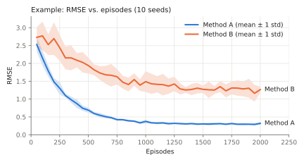

# Reinforcement Learning: Course Projects

Projects for the Reinforcement Learning course at Stockholm University (SU).

**Course literature:** Richard S. Sutton and Andrew G. Barto, [*Reinforcement Learning: An Introduction*](http://incompleteideas.net/book/the-book-2nd.html), 2nd edition, MIT Press, 2018. The book is freely available online. The projects refer to it as "Sutton & Barto".

| Project | Topic | Instructions | Helper code |
|---|---|---|---|
| [Project 1](project-1) | Dynamic programming and Monte Carlo methods (ch. 1–5) | [PDF](project-1/instructions/project-1.pdf) | [helpers](project-1/helpers) |
| [Project 2](project-2) | Coming soon | | |
| [Project 3](project-3) | Coming soon | | |

Each released project folder contains:

- `instructions/`: the assignment as a Typst source and compiled PDF.
- `helpers/`: code you may use in your solution.

## Writing your report

Hand in one typed PDF. Follow the exercise numbering (A1, A2, …) so each answer is easy to find, and put your code in an appendix.

Keep it short. Answer each question with a figure or table and a few sentences that say what it shows. Describe what *you* observed, not what the book says should happen.

**Always include a learning curve** for every method you train: a performance measure (error, return or value) against episodes, sweeps or steps. Plot the mean over seeds as a line with a shaded ±1 std band, as in the example below. Each project tells you which other figures it needs.

Every figure should:

- have a number and a caption, and be referred to in the text,
- have labelled axes, and a legend when it shows more than one curve,
- use a log axis when values span several orders of magnitude,
- use the same colour for the same method throughout the report,
- show one message; split it into two figures if you need two.

Random results need at least 10 seeds. Say how many you used.



*Example of a learning-curve figure (synthetic data).* The helper code includes a function for this plot (`plot_mean_std` in Project 1).

## Building the PDFs

```sh
typst compile --root . project-1/instructions/project-1.typ
```
